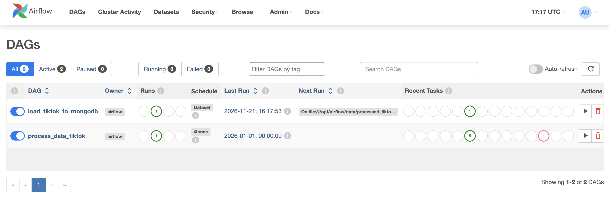
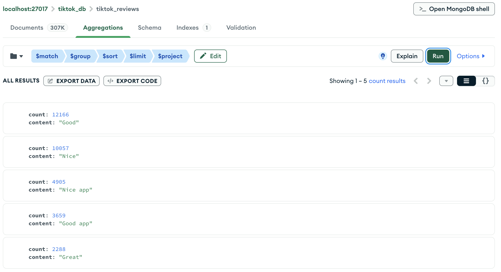
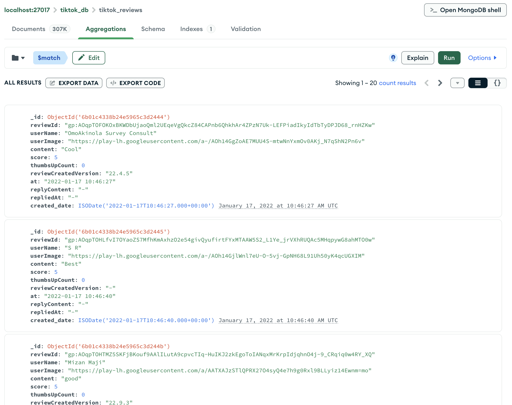
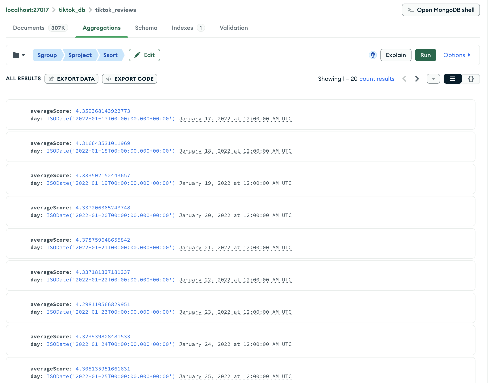

# ETL-пайплайн Airflow + MongoDB (Отзывы TikTok)

Учебный проект по загрузке, очистке и анализу отзывов пользователей TikTok (307 057 записей) с помощью **Apache Airflow**, **Docker** и **MongoDB**.

## Как всё устроено

Проект состоит из двух DAG-ов в Airflow, которые работают в связке через `Dataset`:

1. **`process_data_tiktok` (обработка и очистка данных)**
   - Ждёт появления CSV-файла в папке `data/` (`FileSensor`).
   - Проверяет, не пустой ли файл (`@task.branch`). Если пустой — останавливает работу.
   - Очищает данные внутри группы задач (`TaskGroup`):
     - заменяет пустые значения на `"-"`;
     - приводит даты к нормальному формату и сортирует отзывы по времени;
     - убирает лишние спецсимволы из текста комментариев.
   - После сохранения чистого файла обновляет `Dataset`, чтобы автоматически запустить второй DAG.

2. **`load_tiktok_to_mongodb` (загрузка в базу данных)**
   - Запускается сам, как только первый DAG закончил обработку.
   - Подключается к MongoDB через `MongoHook` и загружает все 307 057 записей в коллекцию `tiktok_db.tiktok_reviews` частями по 50 000 штук.

## Что использовалось
- **Apache Airflow** (DAGs, Sensors, Branching, TaskGroups, Datasets)
- **MongoDB** и **MongoDB Compass**
- **Python** (Pandas)
- **Docker** и **Docker Compose**

## Структура папок
```text
├── dags/
│   ├── process_data_tiktok.py      # Очистка и подготовка данных
│   └── load_tiktok_to_mongodb.py   # Загрузка данных в MongoDB
├── data/                           # Папка для CSV-файлов (скрыта в .gitignore)
├── screenshots/                    # Скриншоты работы Airflow и запросов в MongoDB
├── docker-compose.yaml             # Настройки контейнеров
├── .gitignore
└── README.md
```

## Как запустить

1. Запустить контейнеры:
   ```bash
   docker compose up -d
   ```
2. Открыть Airflow (`http://localhost:8080`), зайти в **Admin → Connections** и настроить подключение `mongo_default` (`Host`: `mongodb`, `Port`: `27017`, логин и пароль из `docker-compose.yaml`, `Extra`: `{"authSource": "admin"}`).
3. Положить исходный CSV-файл в папку `data/` и включить оба DAG-а в интерфейсе Airflow.

## Запросы в MongoDB Compass

После загрузки данных выполнены 3 проверочных запроса к коллекции `tiktok_reviews`:

1. **Топ-5 самых частых комментариев** (`"Good"`, `"Nice"`, `"Nice app"`, `"Good app"`, `"Great"`).
2. **Все отзывы, где текст короче 5 символов**.
3. **Средняя оценка (`score`) за каждый день** (с датой в формате `ISODate` / `timestamp`).

## Скриншоты

### Работа DAG-ов в Airflow


### Результаты запросов в MongoDB Compass

**1. Топ-5 самых популярных комментариев**


**2. Комментарии короче 5 символов**


**3. Средний рейтинг за каждый день**
